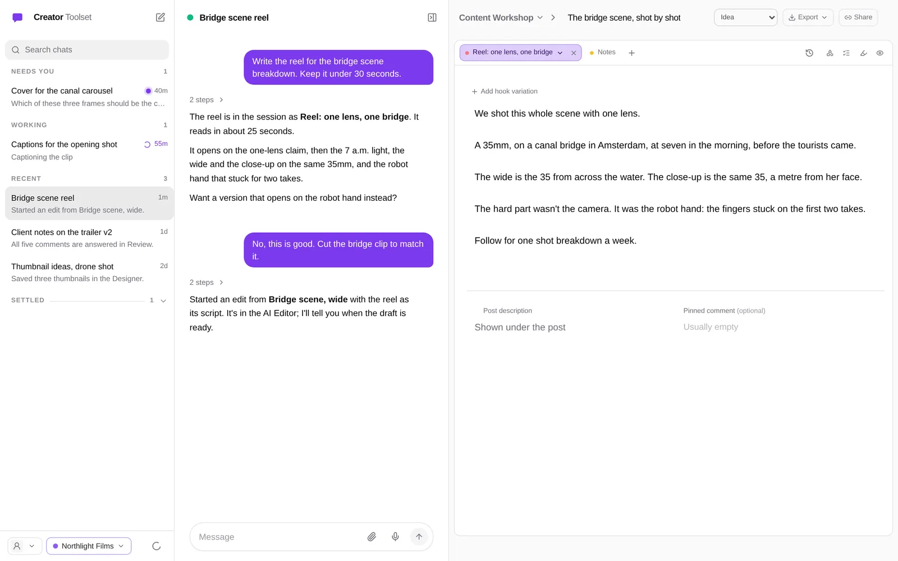
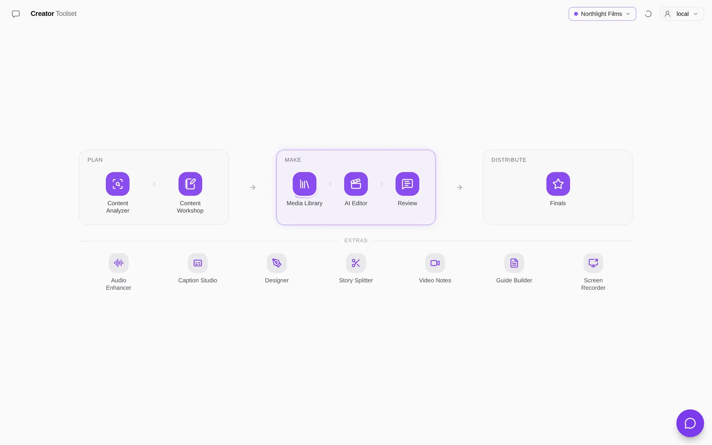
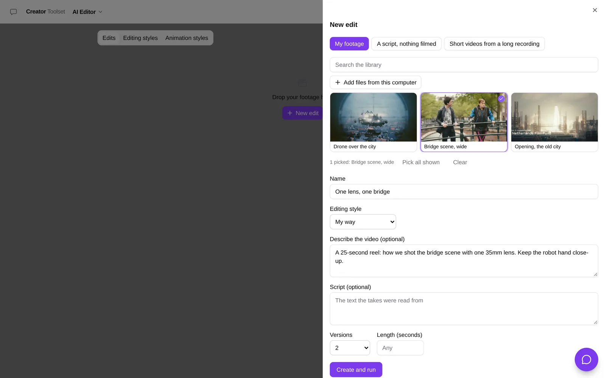
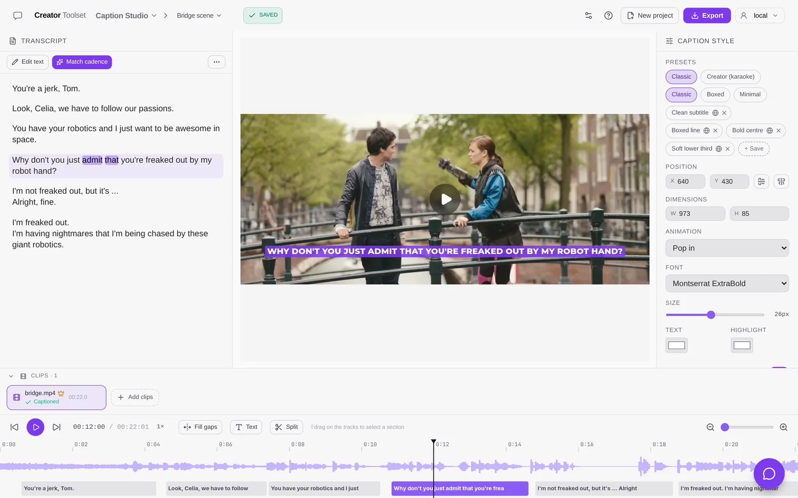
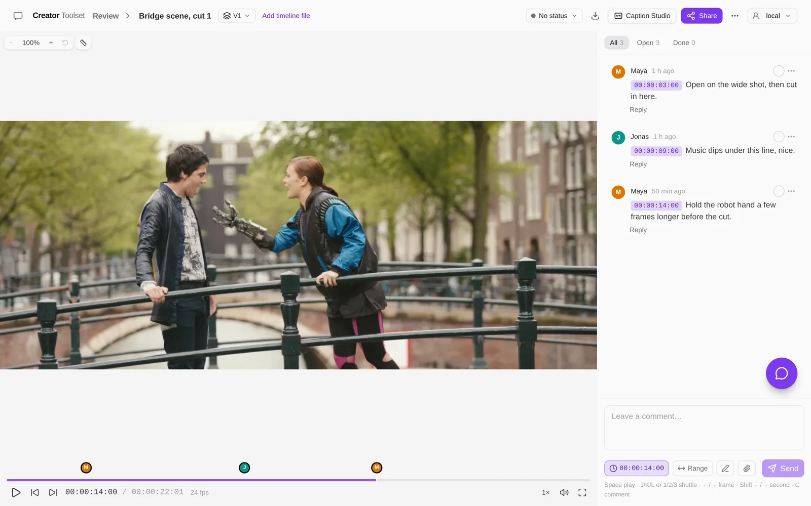

<p align="center">
  
</p>

<h1 align="center">Creator Toolset</h1>

<p align="center">
  An AI video editor and a full creative suite, on your own computer, with the AI plan you already pay for.
  <br />
  <a href="../../releases/latest"><b>Download for Mac</b></a> ·
  <a href="#run-it-from-source">Run from source</a> ·
  <a href="SELF_HOSTING.md">Self-host</a> ·
  <a href="LICENSE">MIT</a>
</p>

<picture>
  <source media="(prefers-color-scheme: dark)" srcset="docs/screenshots/chat-dark.webp" />
  
</picture>

Creator Toolset is for people who make video and content for a living. Research what works, write the script, cut
raw takes into draft timelines, caption them, get a client's notes on the exact frame, and keep the finished pieces
in one place. It is one app with one sign-in and one data folder. Your files stay on your computer or your own server,
and the AI runs on your own account: your Claude, ChatGPT, Gemini or Grok plan, or your own API key.

You can click through every tool, or tell the assistant what you want and watch it happen on the page beside the
chat.

## Talk to it

The assistant answers on the AI app you connected (Claude Code, Codex, Gemini or Grok), and it works with the app's
own tools: it reads and writes your Workshop scripts, finds clips in the Media Library, starts AI Editor edits, answers
Review comments, makes designs and schedules tasks. Drop a video on it and say what you want: it goes to Review, Video
Notes or Caption Studio.

**Chat mode** (the speech-bubble button at the top, or ⌘J) gives the whole window to it: your chats on the left,
grouped into Needs you, Working and Recent, the open chat beside them, and the page that chat is working on to the
right. A new chat starts on **What should we make?**, where you pick a piece of work to carry on with or start
something new. Chats run side by side, so one can cut a video while another writes captions.

What you tell it about yourself and your work it keeps for later chats, in your own words. Settings → Memory lists
what is kept, each with a Remove.

## The tools

<picture>
  <source media="(prefers-color-scheme: dark)" srcset="docs/screenshots/home-dark.webp" />
  
</picture>

Home follows how a video gets made: **Plan → Make → Distribute**, with the **Extras** underneath. Settings → Tools
picks which tiles show.

### AI Editor

<picture>
  <source media="(prefers-color-scheme: dark)" srcset="docs/screenshots/editor-dark.webp" />
  
</picture>

Pick raw takes from the Media Library, or add files from your computer, and say what the video is. The AI picks the
best take of each line and cuts the restarts and pauses. You get draft timelines for your own editor (OTIO and
FCPXML), with a preview in Review, and up to five versions to choose from. **Edit by hand** trims a cut on its own
timeline. In Review you mark changes on the cut's timeline, and **Make the next version** cuts them in, with no AI.

New edit starts from one of three places:

- **My footage**: your takes, as above.
- **A script, nothing filmed**: one of your ElevenLabs voices reads the script and the picture is cut from your B-roll.
- **Short videos from a long recording**: a podcast or a talk goes in, and the parts that stand on their own come out,
  each cut as a short video of its own.

**Editing styles** and **Animation styles** keep how you like your videos cut and your text animated. Make one by
telling the assistant about it, with examples, or with a form.

### Caption Studio

<picture>
  <source media="(prefers-color-scheme: dark)" srcset="docs/screenshots/captions-dark.webp" />
  
</picture>

Drop in a video and it is transcribed with the engine you picked in Settings → AI → Voice: Deepgram or OpenAI on your
key, or a speech model on your own computers. Without either, Whisper runs in your browser. Each line of the transcript
becomes a caption you can edit, restyle and move on the timeline. You export the video with the captions burned in
(MP4, H.264 or H.265), or the captions alone: a transparent overlay (ProRes 4444, VP9 WebM or a PNG sequence) that goes
on top of your edit, or an SRT, WebVTT or ASS file.

### Review

<picture>
  <source media="(prefers-color-scheme: dark)" srcset="docs/screenshots/review-dark.webp" />
  
</picture>

Upload a cut and share one link. Reviewers comment on the exact frame, draw on the picture, and approve or ask for
changes, all without an account. Each new version stacks on the same video, so you can compare V1 with V2. Upload the
timeline file too (OTIO, FCP 7 XML, FCPXML or EDL) and its tracks show under the player.

Reviewers have to be able to reach the server the link came from. A link from the Mac app opens on that Mac, and on
your own network once **Access from other devices** is on and you put the Mac's address in the link in place of
`127.0.0.1`. For a reviewer on the internet you need [your own server](SELF_HOSTING.md).

### Content Workshop

This is where you write reel scripts, carousels, ads, YouTube scripts, newsletters, X threads and articles (the right
half of the first picture). Research a topic across the posts you've saved, keep notes, and draft with AI in your own
voice, using a storytelling framework you pick. Before you post, **Check accuracy** tests the claims against the web.
Each project keeps its own instructions (who you write for, how you sound, what never to say), and the AI reads only
the project you're in.

### And the rest

| Stage | Tool | What you do with it |
|---|---|---|
| Plan | **Content Analyzer** | Save Instagram accounts and posts, and YouTube videos, with captions, transcripts, comments and numbers. Search them, rate each from one to five stars, and sort by rating or plays. With a TypeSafe Jev key, an account's page adds **What works**: how its posts did by hook, format and call to action. |
| Make | **Media Library** | Your footage in one place, searchable by what is said in it, with watch folders, folders, smart folders, share links and a trash. It can keep the files on your computer, on Bunny Storage, or on Amazon S3 or Cloudflare R2. |
| Distribute | **Finals** | Your finished reels, carousels and other pieces: the versions of each, the winner, and where it was posted. |
| Extras | **Audio Enhancer** | Clean up the sound of a recording, with a before-and-after player. |
| Extras | **Designer** | Carousels, covers and thumbnails on a canvas of frames: your AI designs them (text, shapes, pictures, its own drawings), you move, resize, retype and restyle anything, and export each frame as a PNG. Start from a Workshop carousel, a video's frame, a picture you drop in, or a blank canvas. |
| Extras | **Story Splitter** | Cut a video into stories of about 20 seconds, on its own cuts, pauses and beats, and download them as one zip. |
| Extras | **Video Notes** | Screen and camera recordings. Each one gets a transcript and, with an AI connected, a title, a summary and chapters. |
| Extras | **Guide Builder** | Put recordings in order, have AI draft a step-by-step page, and publish it as an unlisted link. |
| Extras | **Screen Recorder** | In the Mac app, on macOS 15 or newer: record your screen, a window, an area or a connected iPhone or iPad, with your camera, your voice and the Mac's sound. Make a version that zooms where you clicked and follows your face, and send it to Review, Video Notes, the Guide Builder or the AI Editor; or one with no background, saved as a video with a transparent background to lay over other video. |

On Home, Review sits in Make, the Content Workshop in Plan and Caption Studio in the Extras.

## Your own AI, your own keys

Creator Toolset doesn't come with an AI account. You bring your own, in one of two ways:

1. **Your subscription, on your computer.** Sign in to Claude Code, Codex, Gemini or Grok with the plan you already
   have. The Mac app passes your requests to it, and only yours. Setup finds the ones on your Mac and installs or signs
   in with one button; Settings → Providers lists them.
2. **Your API key.** Add an Anthropic key in Settings → API keys. Anthropic bills you directly.

Every other paid service works the same way: transcription, voices, audio engines, research and Apify each run on a
key you add, and that provider bills you. Instagram is read only through the official login (for your own posts) and
your own Apify key (for other creators), never by scraping web pages.

**Speech** is set in Settings → AI → Voice: the languages spoken in your videos, and for captions, Media Library
transcripts, the AI Editor and talking to the assistant, which engine hears it. That can be Deepgram or OpenAI on your
key, or Whisper and Parakeet models running on your own computers, a Mac or a Linux machine (Settings → Devices → Add
computer). The same page turns on reading the assistant's replies aloud.

**Your own AI chat.** You can skip the window and work from the AI app you already use. Creator Toolset adds itself to
Claude Code or Codex as an MCP server with one click, and Settings → Headless access gives the address and a key for
any other MCP app. ChatGPT and Claude can sign in to it with your account instead of a key. From that chat you can
draft and edit Workshop pieces, read and resolve Review comments, run AI Editor steps and schedule tasks.
[Connect your AI](apps/captions/docs/features/connect-your-ai.md) has the steps.

Without any AI, the rest still works. Captions transcribe in the browser, and Review, Story Splitter and the Media
Library need no AI at all.

## Make it work your way

The app is open source, so your AI can change it for you. Give this repository to Claude Code, Codex or another coding
AI and say what you want different: a tool you miss, a step that should go another way, a page for your own process.
It builds that as a **plug-in**, a folder of your own. With the Mac app you install nothing: your AI writes the folder,
and you switch it on in Community → Installed. The app's code stays as it is, so you keep getting updates.
[PLUGINS.md](PLUGINS.md) tells your AI how.

**Community** has plug-ins and packs for each tool: writing frameworks, writing guides, caption styles, editing
styles, Analyzer guides and Home layouts. Settings → Tools shows what is added to each tool.

## Run it on your Mac

The Mac app (Apple silicon, macOS 14 or newer; its Screen Recorder needs macOS 15) has the whole server inside it, so
there's nothing else to install.

1. **Download it** from [Releases](../../releases/latest): open the disk image and drag Creator Toolset to
   Applications. It updates itself after that.
2. **Open it.** It starts the server and makes your account. It doesn't ask for a password, because the account's
   secret is kept in your Keychain.
3. **Follow the setup.** Five short screens: **Pick your look**; **Connect your AI** (the AI apps on this Mac for the
   ChatGPT, Claude, Google, Grok or Meta plan you already have, each with Install, Sign in or Connect); **What do you
   make?** (turns on the tools that fit and makes your first project); **What do you want to do first?**; and **How do
   you work best?** (talk to your AI in the app, in your own AI, or both). For your own AI, a last screen adds Creator
   Toolset to Claude Code or Codex with one click. Sign-in, the Instagram login and other keys are optional.
4. **Use it from other devices (optional).** Turn on **This Mac → Access from other devices** (Servers → This Mac… in
   the app's menu bar) and choose a password. Phones and other computers sign in with it.

Your data lives in `~/Library/Application Support/Creator Toolset/data`. You can move it to an external disk in
**This Mac → Data location**.

The app also does **dictation** anywhere on your Mac: press a talk key (F13 by default, or hold fn), speak, and the
words are pasted where the cursor is. It is set in Settings → AI → Voice → Dictation and runs on this Mac or on your
key.

The downloaded app sends anonymous usage and crash reports to creatortoolset.com, which may pass them to PostHog and
Sentry. A report holds a random install id, the version and system, which of the app's pages were opened and how often,
whether Connect is on, which kinds of AI are set up, and the message and code location of any error. It never holds
your name, account, files or content. Turn it off in **Settings → General → Send anonymous usage and crash reports**.
A server you build or host yourself sends none (`api/lib/telemetry.ts`).

The **Servers** menu, or the picker right of the window buttons, switches the window between this Mac's server and any
server of yours added by address (⌥⌘1…⌥⌘9). **Servers → Run your own server…** walks you through one. More in
[apps/mac/README.md](apps/mac/README.md).

## On your phone

[apps/ios](apps/ios/README.md) is the iPhone app: your chats with the assistant, your edits and Review videos, uploads
from the camera roll that keep going with the phone locked, your finals, and your scripts to read while you film. It
talks to any Creator Toolset server, your Mac included. You build it yourself in Xcode for now; add the phone in
Settings → Devices → Add phone.

## Run it from source

You need Node.js 22+, [pnpm](https://pnpm.io) 10 (`corepack enable`), and `ffmpeg` and `zip` on your PATH.

```sh
git clone <this repository> creator-toolset
cd creator-toolset
pnpm install
pnpm --filter @creator-toolset/captions dev   # http://localhost:43127
```

With no `.env`, sign-in is off and you are the local admin. Projects are kept in `~/.caption-studio` (set `DATA_DIR`
to change it). Every setting is explained in [apps/captions/.env.example](apps/captions/.env.example). `pnpm test` and
`pnpm check` run the tests and the type check.

## Run it on your own server

[SELF_HOSTING.md](SELF_HOSTING.md) is written so that you, or an AI agent, can follow it step by step. It covers
choosing a server and a domain, starting the Docker kit (the app plus Caddy for HTTPS), connecting the Mac app,
backups and updates. On the server, `apps/captions/scripts/setup-server.sh <your domain>` writes `.env` with a random
`APP_SECRET` and starts the kit in one go. `docker compose exec app node scripts/doctor.mjs` checks the running install
and lists what's missing.

To let your own computers join one account through Cloudflare Tunnel, run the Connect broker in
[apps/relay/](apps/relay/) with your own Cloudflare zone. [docs/operations/self-host-relay.md](docs/operations/self-host-relay.md)
is the step-by-step guide.

## Repository

| Path | What |
|---|---|
| [`apps/captions/`](apps/captions/README.md) | The web app and its server: React, Vite, Hono, tRPC, TypeScript |
| [`apps/mac/`](apps/mac/README.md) | The Mac app (SwiftUI) |
| [`apps/ios/`](apps/ios/README.md) | The iPhone app (SwiftUI) |
| [`apps/relay/`](apps/relay/) | The Connect broker: your computers in one account, and the sign-in for AI apps |
| [`apps/obsidian/`](apps/obsidian/README.md) | The Obsidian plugin: vault notes and Workshop sessions kept in step |
| [`SELF_HOSTING.md`](SELF_HOSTING.md) | Running it on your own server |
| [`docs/operations/self-host-relay.md`](docs/operations/self-host-relay.md) | Running the Connect broker on your own server |
| [`PLUGINS.md`](PLUGINS.md) | Changing the app for yourself with a plug-in |
| [`AGENTS.md`](AGENTS.md) | Rules and commands for contributors and their coding agents |

## Contributing

Read [AGENTS.md](AGENTS.md) first. Turn on the repository hooks once per clone with
`git config core.hooksPath .githooks`. They block any commit that contains a secret or a private name.

## License

[MIT](LICENSE). Copyright (c) 2026 Creator Toolset contributors.

The fonts in `apps/captions/public/fonts/` are Google Fonts under the SIL Open Font License 1.1 (see `OFL.txt` there).
Other third-party parts, including the GPL FFmpeg build that the Docker image downloads, are listed in
[THIRD_PARTY_NOTICES.md](THIRD_PARTY_NOTICES.md).

The footage in the screenshots is from *Tears of Steel*, (CC) Blender Foundation | [mango.blender.org](https://mango.blender.org),
licensed [CC BY 3.0](https://creativecommons.org/licenses/by/3.0/). The studio, people and comments around it are
made up for the screenshots.
