<p align="center">
  <picture><source media="(prefers-color-scheme: dark)" srcset="apps/captions/public/icons/icon-192.png" />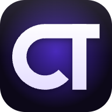</picture>
</p>
<!-- One tile reads on both themes. If a light and a dark mark are drawn later, point each source at its own file. -->

<h1 align="center">Creator Toolset</h1>

<p align="center"><b>Plan, make and review your video and posts, on your own computer, with the AI you already pay for.</b></p>

<p align="center">
  One Mac app with the whole server inside: find the posts that work, write the script, cut the raw takes,
  caption the result, and get a client's notes on the exact frame.
</p>

<p align="center">
  <a href="LICENSE"></a>
  
</p>

<p align="center">
  <a href="../../releases/latest"><b>Download for Mac</b></a> ·
  <a href="#phone">Phone</a> ·
  <a href="https://creatortoolset.com/docs"><b>Docs</b></a> ·
  <a href="SELF_HOSTING.md">Self-host</a> ·
  <a href="https://creatortoolset.com/docs/plug-ins-and-packs">Plug-ins</a>
</p>

<!-- Demo video (30-60 s, not uploaded yet): drag the MP4 into GitHub's web editor, then put the returned user-attachments URL alone on a line here (in place of the GIF below), captioned "Watch the 1-minute tour". -->
<p align="center">
  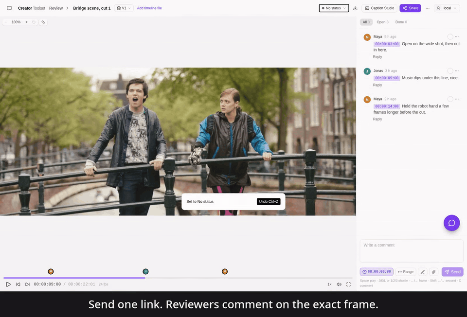<br />
  <sub>Review: a click on a comment jumps the video to its frame.</sub>
</p>

<table>
<tr>
<td width="50%" valign="top"><h3>🖥️ Your machine</h3>Your files stay in one data folder on your Mac, or on a server you run. Nothing goes to Creator Toolset by default.</td>
<td width="50%" valign="top"><h3>🔑 Your AI, your keys</h3>The app has no AI of its own. Use the subscription you already have, paste an API key, or run a model on your own machine. Each service gets only what its feature needs.</td>
</tr>
<tr>
<td width="50%" valign="top"><h3>🧩 Change it with your AI</h3>Packs change how an AI writes or how a caption looks. Plug-ins add features to your copy of the app.</td>
<td width="50%" valign="top"><h3>💬 Drive it from your chat</h3>Connect Claude Code, Codex, ChatGPT or Claude, and they can read and change your work from their own chat.</td>
</tr>
</table>

## Right for you if

- You caption in one app, send review links from another and paste scripts into a third.
- Clients say "the thing at the end", and you want them to point at second 14 instead of writing a paragraph.
- You come back from a long recording with one good minute and no time to find it.
- You want to search your footage by what is said, what is shown or what happens, with no tags.
- You already pay for Claude, ChatGPT, Gemini or Grok, and you do not want a second subscription.

Not for you if you need a Windows or Android app (there is none), or a hosted service with no setup (Creator Toolset Cloud is not open to add yet).

<p align="center">
  <a href="#tools">Tools</a> · <a href="#chat-mode">Chat</a> · <a href="#your-ai">Your AI</a> · <a href="#built-for-agents">Agents</a> · <a href="#phone">Phone</a> · <a href="#contributing">Contributing</a>
</p>

## Tools

Four groups on Home: Plan, Make, Distribute and Extras. The tools share one library, one set of workspaces and one AI setup.

<p align="center">
  <picture><source media="(prefers-color-scheme: dark)" srcset="docs/screenshots/home-dark.webp" />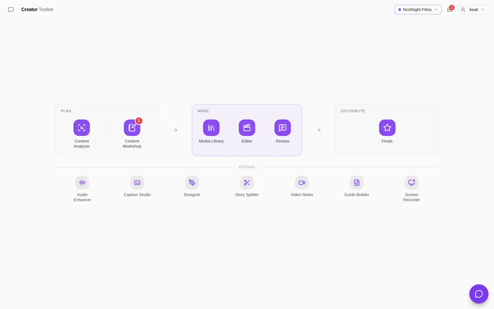</picture>
</p>

### Plan

<table>
<tr>
<!-- shot: content-analyzer: the Content Analyzer list of saved posts sorted by virality, each marked with the Workshop idea it went to, two picked, and the selection bar with Kept for, Add to topic and Send to Content Workshop (light and dark: docs/screenshots/content-analyzer-light.webp, content-analyzer-dark.webp) -->
<td width="50%" valign="top"> <picture><source media="(prefers-color-scheme: dark)" srcset="docs/screenshots/content-analyzer-dark.webp" />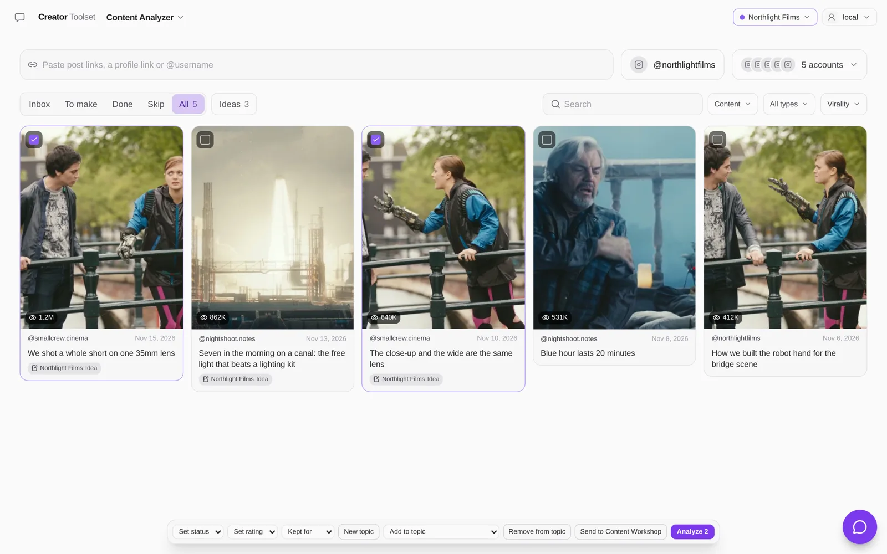</picture> <br><sub>Saved posts sorted by virality, with the best ones picked for a Content Workshop session.</sub> <h4>Content Analyzer</h4> Save the posts you learn from, paste links or a profile, and sort by rating, virality or plays. Group posts that share a hook. Needs an Apify key, or your own Instagram sign-in.<br> <a href="https://creatortoolset.com/docs/content-analyzer">Learn more</a> </td>
<!-- shot: content-workshop: a Content Workshop session (three saved posts as sources) with the reel draft beside the chat, and the accuracy check open over it: a contradicted and a partly supported claim with their rewordings, the other claims supported, a 0 to 100 score (light and dark: docs/screenshots/content-workshop-light.webp, content-workshop-dark.webp) -->
<td width="50%" valign="top"> <picture><source media="(prefers-color-scheme: dark)" srcset="docs/screenshots/content-workshop-dark.webp" />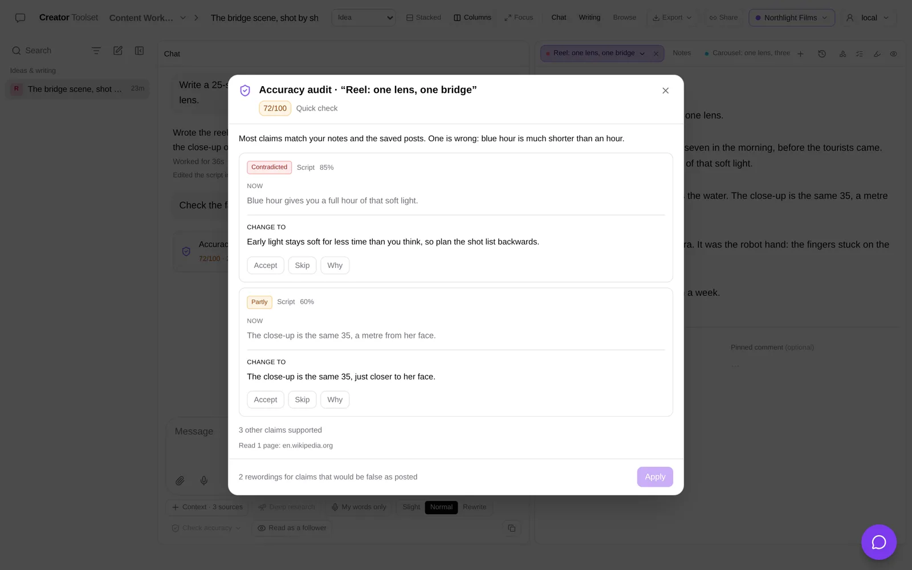</picture> <br><sub>A reel draft from the sources, revised in chat, with each claim checked against them.</sub> <h4>Content Workshop</h4> Draft a reel, carousel or ad from the sources, or write a script, newsletter or thread in the chat. Each project keeps one brand's voice and files apart from the rest.<br> <a href="https://creatortoolset.com/docs/content-workshop">Learn more</a> </td>
</tr>
</table>

### Make

<table>
<tr>
<!-- shot: media-library: the Media Library with a search for a phrase, each hit (a transcript line or a shot) listed at its second beside the clip it is in (a hit opens the clip there, with More like this and the shot-quality marks) (light and dark: docs/screenshots/media-library-light.webp, media-library-dark.webp) -->
<td width="50%" valign="top"> <picture><source media="(prefers-color-scheme: dark)" srcset="docs/screenshots/media-library-dark.webp" />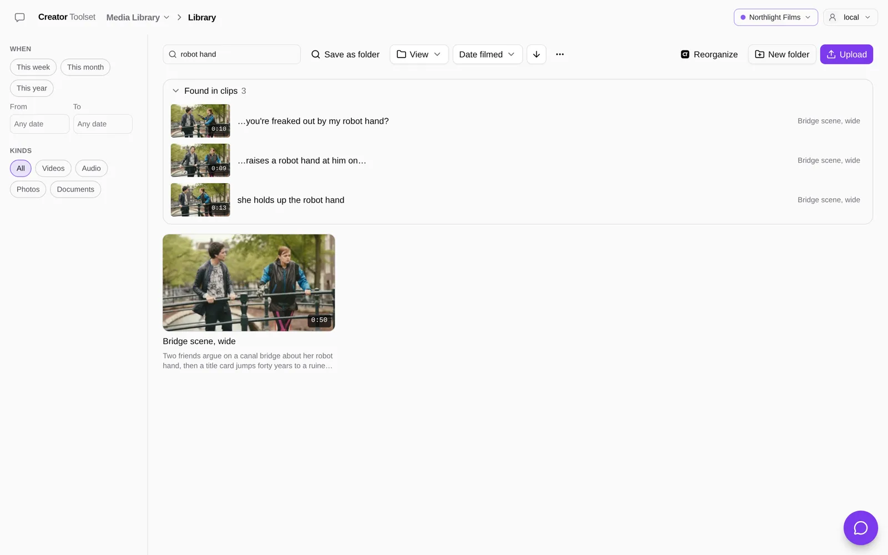</picture> <br><sub>A search for a phrase opens each clip at the second it is said.</sub> <h4>Media Library</h4> Search by words, by meaning (needs an OpenAI key) or by picture. Smart folders fill from a rule in plain words, and footage folders on your computer join as new videos arrive. Reorganize proposes a sort you can accept.<br> <a href="https://creatortoolset.com/docs/media-library">Learn more</a> </td>
<td width="50%" valign="top"> <picture><source media="(prefers-color-scheme: dark)" srcset="docs/screenshots/editor-dark.webp" />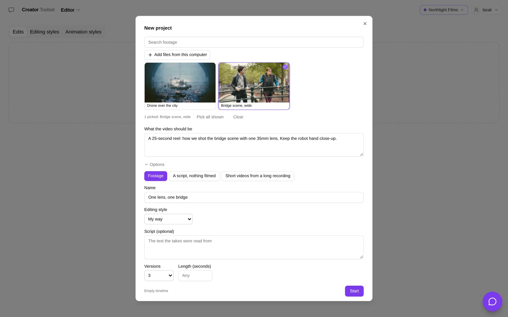</picture> <br><sub>A new project: pick the footage, say what the video is, choose a style, and ask for up to five versions.</sub> <h4>Editor</h4> Raw takes or a script in, draft timelines out. Check each version, then cut by hand on the timeline. Export OTIO for Resolve or FCPXML for Final Cut Pro.<br> <a href="https://creatortoolset.com/docs/editor">Learn more</a> </td>
</tr>
<tr>
<!-- shot: review: the Review page with three frame-stamped comments from two reviewers and their markers on the timeline (light and dark: docs/screenshots/review-light.webp, review-dark.webp) -->
<td colspan="2" width="100%" valign="top"> <picture><source media="(prefers-color-scheme: dark)" srcset="docs/screenshots/review-dark.webp" />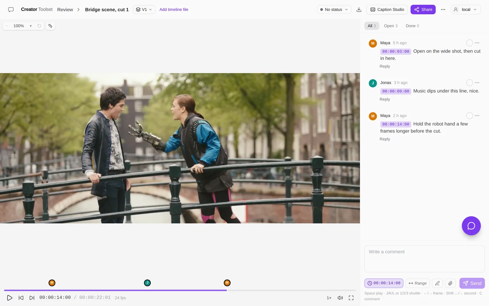</picture> <br><sub>Comments pinned to the frame, from people who never made an account.</sub> <h4>Review</h4> Share one link. Reviewers type a name, comment on a frame or a range, and draw on the picture. Every version has a status, and you can cut the next one from the marks with no AI.<br> <a href="https://creatortoolset.com/docs/review">Learn more</a> </td>
</tr>
</table>

### Distribute

Finals holds the finished videos you will post, each one a reel, carousel or other piece with one winning version
([help](https://creatortoolset.com/docs/finals)).

### Extras

<table>
<tr>
<td width="50%" valign="top"> <picture><source media="(prefers-color-scheme: dark)" srcset="docs/screenshots/captions-dark.webp" />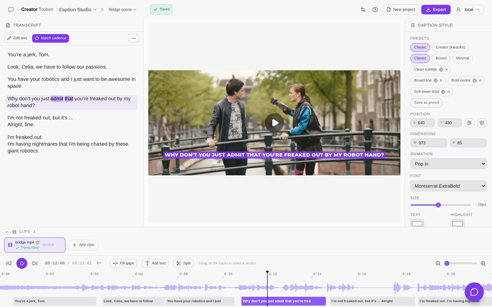</picture> <br><sub>The transcript, the caption style and the caption blocks on the timeline, in one view.</sub> <h4>Caption Studio</h4> Transcribe with Deepgram, OpenAI, a speech model on your computer or Whisper in the browser. Export MP4 with captions burned in, or captions alone as ProRes 4444, VP9 WebM or a PNG sequence for an overlay.<br> <a href="https://creatortoolset.com/docs/caption-studio">Learn more</a> </td>
<!-- shot: designer: a Designer canvas with a three-frame carousel, its layers list, the fill and stroke lists beside the frame, and the PNG export button (light and dark: docs/screenshots/designer-light.webp, designer-dark.webp) -->
<td width="50%" valign="top"> <picture><source media="(prefers-color-scheme: dark)" srcset="docs/screenshots/designer-dark.webp" />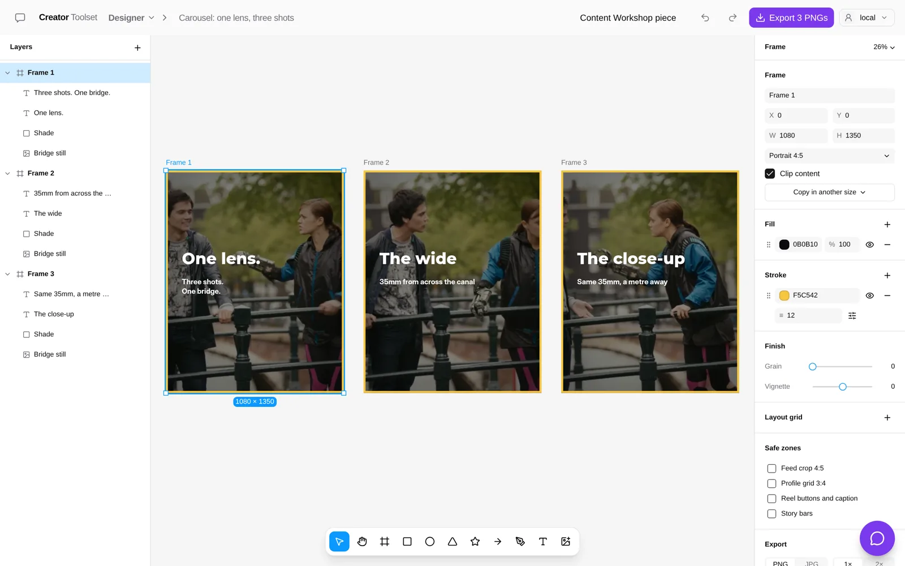</picture> <br><sub>A three-frame carousel as layers, each frame exported at its exact size.</sub> <h4>Designer</h4> Carousels, covers and thumbnails as editable layers. Keep a carousel style and start the next one from it. Export each frame as a PNG at its exact size.<br> <a href="https://creatortoolset.com/docs/designer">Learn more</a> </td>
</tr>
<tr>
<!-- shot: story-splitter: one finished video cut into numbered stories of about 20 seconds on a timeline, with the cut markers and a download ZIP button (light and dark: docs/screenshots/story-splitter-light.webp, story-splitter-dark.webp) -->
<td width="50%" valign="top"> <picture><source media="(prefers-color-scheme: dark)" srcset="docs/screenshots/story-splitter-dark.webp" />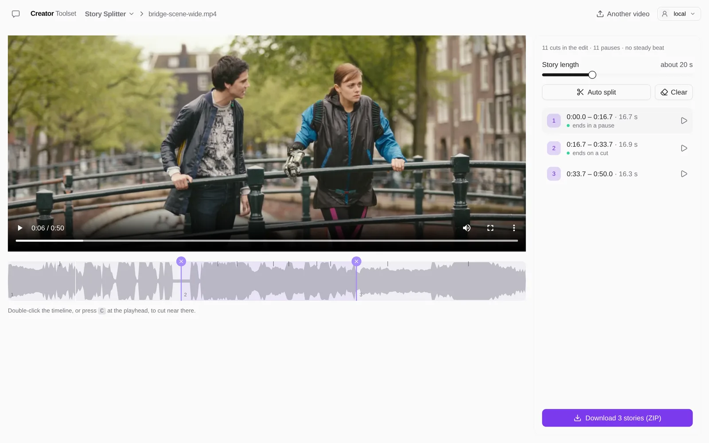</picture> <br><sub>One finished video, cut into numbered stories of about 20 seconds.</sub> <h4>Story Splitter</h4> Runs in the browser, with no AI key and no upload. Add or remove cuts by hand, then download the numbered MP4s as one ZIP.<br> <a href="https://creatortoolset.com/docs/story-splitter">Learn more</a> </td>
<!-- shot: video-notes: the Video Notes page for one recording, its chapters beside the player, and the takeaways and summary under it (light and dark: docs/screenshots/video-notes-light.webp, video-notes-dark.webp) -->
<td width="50%" valign="top"> <picture><source media="(prefers-color-scheme: dark)" srcset="docs/screenshots/video-notes-dark.webp" />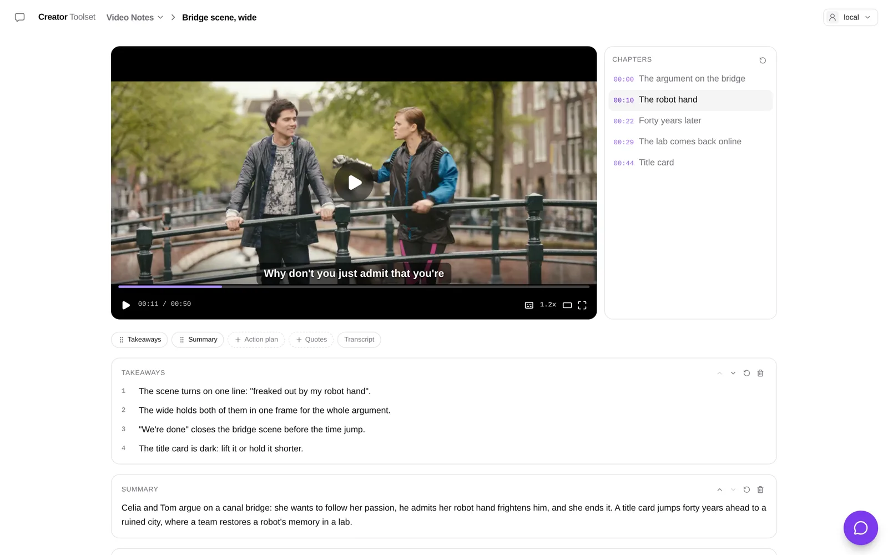</picture> <br><sub>Chapters beside the player, with takeaways and a summary under it.</sub> <h4>Video Notes</h4> Drop in a screen or camera recording and get a transcript with word timings. Ask for takeaways, an action plan, a summary, chapters or quotes.<br> <a href="https://creatortoolset.com/docs/video-notes">Learn more</a> </td>
</tr>
<tr>
<!-- shot: guide-builder: a five-step guide made from a screen recording, its first step with the screenshot cut from the recording, and Share set to Anyone with the link (light and dark: docs/screenshots/guide-builder-light.webp, guide-builder-dark.webp) -->
<td width="50%" valign="top"> <picture><source media="(prefers-color-scheme: dark)" srcset="docs/screenshots/guide-builder-dark.webp" />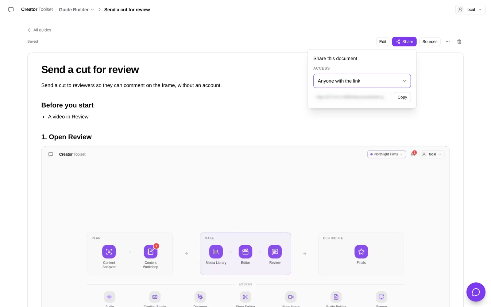</picture> <br><sub>Each step gets the screenshot from the moment it describes.</sub> <h4>Guide Builder</h4> A guide from one recording (up to 12 steps), or a document from up to eight recordings in order. Check the steps against the recording, then share by link.<br> <a href="https://creatortoolset.com/docs/guide-builder">Learn more</a> </td>
<!-- shot: audio-enhancer: the Audio Enhancer with a Before and After switch on the player, a Strength control and the choice between NVIDIA Studio Voice and ElevenLabs Voice Isolator (light and dark: docs/screenshots/audio-enhancer-light.webp, audio-enhancer-dark.webp) -->
<td width="50%" valign="top"> <picture><source media="(prefers-color-scheme: dark)" srcset="docs/screenshots/audio-enhancer-dark.webp" />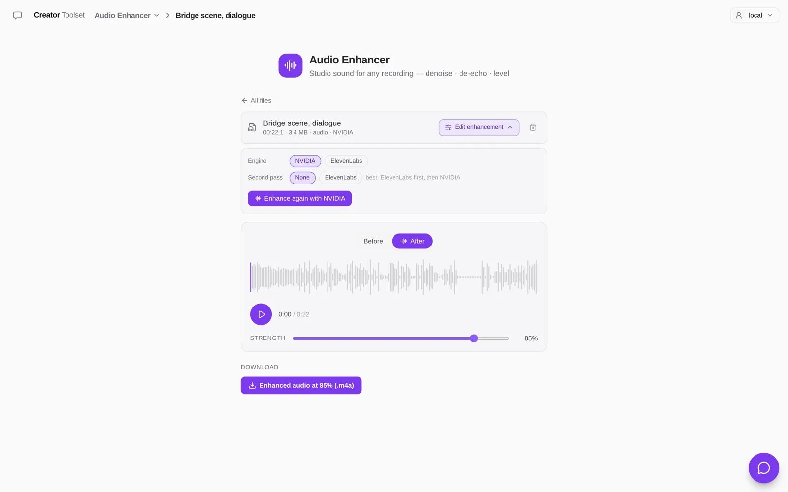</picture> <br><sub>Before and after the cleanup, with Strength to mix the original back in.</sub> <h4>Audio Enhancer</h4> Take the noise and room sound out of one recording, with NVIDIA Studio Voice or ElevenLabs Voice Isolator. Needs an NVIDIA or ElevenLabs key. Compare the clean voice with the original, then download it.<br> <a href="https://creatortoolset.com/docs/audio-enhancer">Learn more</a> </td>
</tr>
</table>

The Screen Recorder (Mac app, macOS 15 or newer) records a screen, window or area with your camera and voice, then sends the
take to Review or Video Notes ([help](https://creatortoolset.com/docs/screen-recorder)). Dictation types your words wherever the
cursor is: press F13, with Microphone and Accessibility permission ([help](https://creatortoolset.com/docs/dictation)).

## Chat mode

Open the assistant in chat mode and the window has three parts: your chats on the left, the open chat in the middle, and
the page you are working on at the right. Ask in plain words, such as "draft three carousels from the posts I saved this
week". It finds the right tool and makes the change. Anything that changes a file on your Mac waits for your confirmation.

<p align="center">
  <picture><source media="(prefers-color-scheme: dark)" srcset="docs/screenshots/chat-dark.webp" />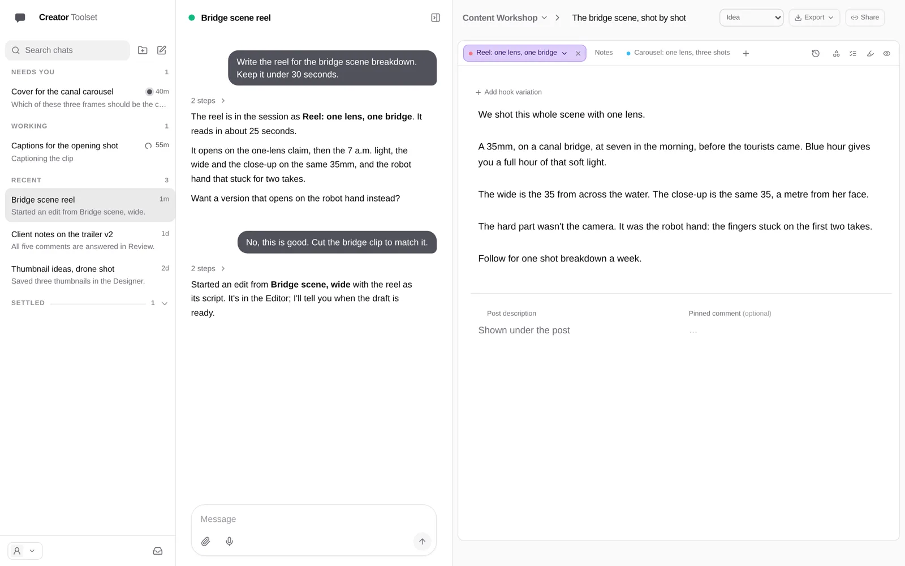</picture>
</p>

The chat list keeps your last 100 chats, each marked with its workspace, and you can filter to one workspace. [Assistant help](https://creatortoolset.com/docs/assistant).

## Phone

The iPhone app talks to any Creator Toolset server, your Mac included. Chat with the assistant, watch your edits and Review
videos, upload from the camera roll (uploads keep going with the phone locked), and read your scripts while you film. Pair
it in **Settings → Computers → Add phone**, which shows a QR code. A phone reaches your Mac only while the Mac app runs
with **Network access** on. For now you build the app yourself in Xcode from
[apps/ios](apps/ios).

## Workspaces and teams

Each workspace is a separate space for one client or project. On a hosted server you invite people by email or link and
choose which apps and workspaces each one gets ([help](https://creatortoolset.com/docs/teams)).

## Built for agents

Every server has an address that AI apps use to reach your work: MCP, at `/api/mcp`. An AI app you already use can read and
change your work: find clips, draft Workshop pieces, start Editor edits, read and answer Review comments. Changes show in
the app at once. **Settings → Headless access** adds Creator Toolset to Claude Code or Codex in one click. For any other AI
app, create a key on the **Another app** row.

With the server added to Claude Code, you can ask:

> Find the clips where I talk to camera, cut a 30-second reel from them in the Editor, and send the cut to Review for my client.

The agent works through tools such as `media_search`, `editor_create` and `review_share`. Plug-in tools that remove things
ask you before they run. Removing a row in Headless access ends that connection and its key.

For another AI app on this Mac, the Mac app's own server is at `http://127.0.0.1:43128`:

```json
{
  "mcpServers": {
    "creator-toolset": {
      "type": "http",
      "url": "http://127.0.0.1:43128/api/mcp",
      "headers": { "Authorization": "Bearer <key from Settings → Headless access>" }
    }
  }
}
```

Details: [Headless access](https://creatortoolset.com/docs/headless-access). The tools are in
[apps/captions/api/mcp-tools](apps/captions/api/mcp-tools).

## Your files

Your files live in one data folder, `~/Library/Application Support/Creator Toolset/data` by default. You can move it to an
external disk from **This Mac → Data location**. Clear frees only the copies the app made, such as proxies and downloaded
models, never your original video. A trashed clip stays in the trash for 14 days by default. [Storage help](https://creatortoolset.com/docs/storage).

## Your AI

The app has no AI of its own. You connect one, and you choose a provider and model for each kind of work in
[AI by job](https://creatortoolset.com/docs/ai-by-job).

- **Your subscription.** The Mac app runs the AI app you installed (Claude Code, Codex, Gemini CLI or Grok) under your own
  sign-in. Requests go only to that app. Antigravity works too, with a Google sign-in and no key.
- **Your API keys.** **Settings → API keys** holds keys for Anthropic, OpenAI, Gemini, Deepgram, ElevenLabs, NVIDIA,
  Perplexity, Apify, YouTube and more. Only the last four characters are shown.
- **A model on your own machine.** Set a **Local model** address, such as `http://localhost:11434`, and the tools use it
  first. Hosted servers refuse it.
- **Speech on your own computer.** Whisper and Parakeet run on a Mac or Linux computer you add. A computer is a Mac or Linux
  machine you sign in to your server. Without a key or a speech model, Caption Studio transcribes in the browser.
- **Social accounts.** Sign in to Instagram, Facebook, YouTube or TikTok in **Settings → Social accounts**, so Content
  Analyzer can read your numbers and posts. [Connectors help](https://creatortoolset.com/docs/connectors).

Pay-per-use calls are billed by the provider, and a subscription counts against its plan. **Settings → Usage** shows what
each tool used. A Gemini key sends a small copy of each video it watches to Google, and a free Gemini key has daily limits
set by Google. [Connect your AI](https://creatortoolset.com/docs/connect-your-ai) walks through each route.

## Plug-ins

Packs are data. They change how an AI writes, how a caption looks or how Home is laid out, and they cannot change who may
open a tool. Plug-ins add features to your copy of the app. Browse both in **Community**, from the account menu at the top
right, and switch each one on for all workspaces or only some. The five starter packs are in
[apps/captions/packs](apps/captions/packs).

The Obsidian plug-in keeps one vault folder in step with your Content Workshop projects, both ways
([help](https://creatortoolset.com/docs/obsidian-plugin)). To make your own, see [Plug-ins and packs](https://creatortoolset.com/docs/plug-ins-and-packs) and
[PLUGINS.md](PLUGINS.md).

## Download

The Mac app is the one app you install, and there is no Windows or Android app yet. It has the server inside, a **Servers**
menu to switch between This Mac and any server of yours (⌥⌘1 to ⌥⌘9), a menu bar item, and it updates itself. The download is
`CreatorToolset-<version>.dmg`, signed and notarized by Apple.

| You want | Get it | You need |
|---|---|---|
| The Mac app | [Download for Mac](../../releases/latest) | Apple silicon, macOS 14 or newer (Screen Recorder needs 15) |
| The iPhone app | Build [apps/ios](apps/ios) in Xcode | A Mac or server to pair with |
| Your own server | [SELF_HOSTING.md](SELF_HOSTING.md), the Docker kit | x86_64 Linux, 4 vCPU, 8 GB RAM, ports 80 and 443 open, a domain |
| From source | The commands below | Node.js 22 or newer, pnpm 10, `ffmpeg` and `zip` |

The first open shows a few setup screens, each one skippable. From source:

```sh
git clone <this repository> creatortoolset
cd creatortoolset
corepack enable
pnpm install
pnpm --filter @creator-toolset/captions dev   # http://localhost:43127
```

With no `.env`, sign-in is off and you are the local admin. `pnpm test` and `pnpm check` run the tests and the type check.

## Self-host

Run the server on a Linux machine of your own with Docker and HTTPS on your own domain, then connect the Mac app for AI.
[SELF_HOSTING.md](SELF_HOSTING.md) takes you through it one step at a time, with a check after each step. An AI agent can follow it too.

```sh
git clone <this repository> /opt/creator-toolset
cd /opt/creator-toolset
apps/captions/scripts/setup-server.sh your.domain.example
```

Your own computers can join one account through a Cloudflare Tunnel ([apps/relay](apps/relay)).

## What are you selling? Nothing

- **The code is MIT.** Use it, change it, run it for your clients.
- **You bring the AI and the keys.** The public code has no payment or billing.
- **No account is needed for the Mac app.** Its first run offers Sign in with Apple or Google, and you can skip it.
- **Anonymous usage and crash reports** go from the downloaded Mac app to creatortoolset.com. They hold no name, account, file
  or content. Turn them off in **Settings → General → Usage and crash reports**.
- **Creator Toolset Cloud is not open to add yet.** The Mac app shows it as "Coming soon".
- **Limits are written down.** The Mac app needs Apple silicon, the iPhone app is built in Xcode for now, and the Docker
  kit needs x86_64 Linux.

## Contributing

Read [AGENTS.md](AGENTS.md) first. It is the guide for coding agents and for people: the layout of the repo, the commands
to run, and the rules for each app. Found a bug or want a feature? Open an issue. Made a pack or a plug-in?
[PLUGINS.md](PLUGINS.md) explains how to share it.

## License and credits

Creator Toolset is [MIT](LICENSE), copyright 2026 Creator Toolset contributors. The fonts in `apps/captions/public/fonts/` are Google Fonts under the SIL Open Font License 1.1. Other
third-party parts, including the GPL FFmpeg build that the Docker image downloads, are listed in
[THIRD_PARTY_NOTICES.md](THIRD_PARTY_NOTICES.md).

The screenshots show a made-up brand, Northlight Films. The footage is from *Tears of Steel* (Blender Foundation,
[mango.blender.org](https://mango.blender.org)), licensed [CC BY 3.0](https://creativecommons.org/licenses/by/3.0/).
