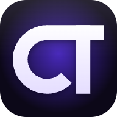
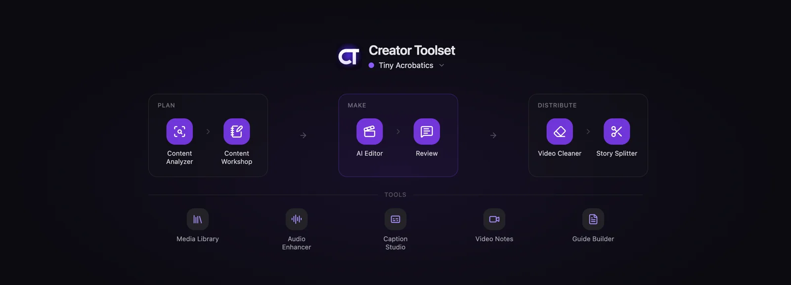
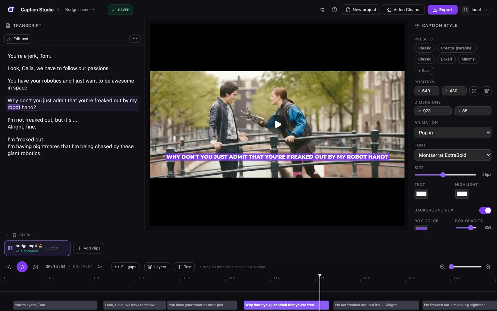
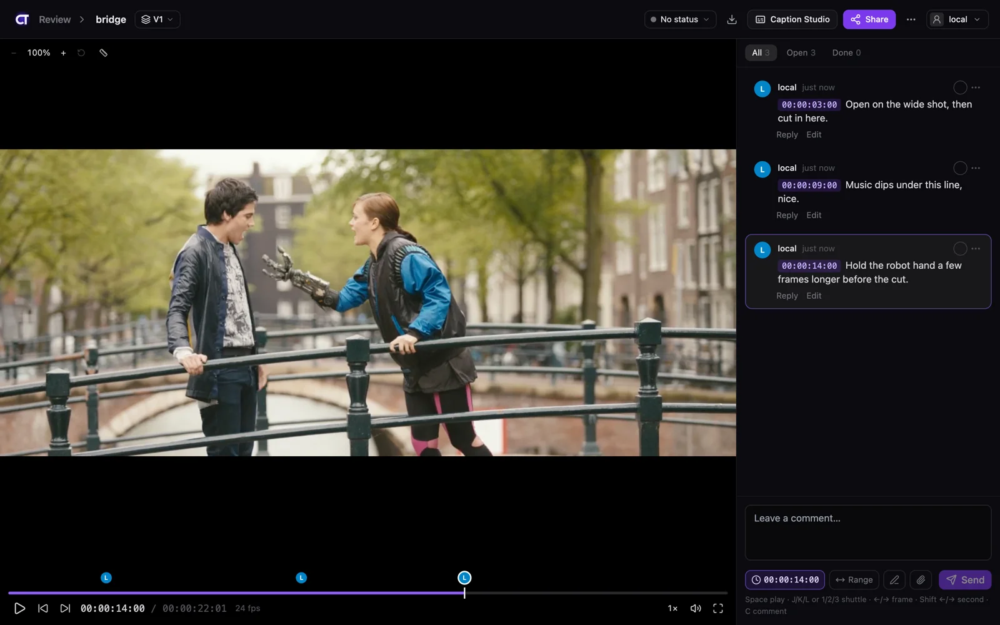
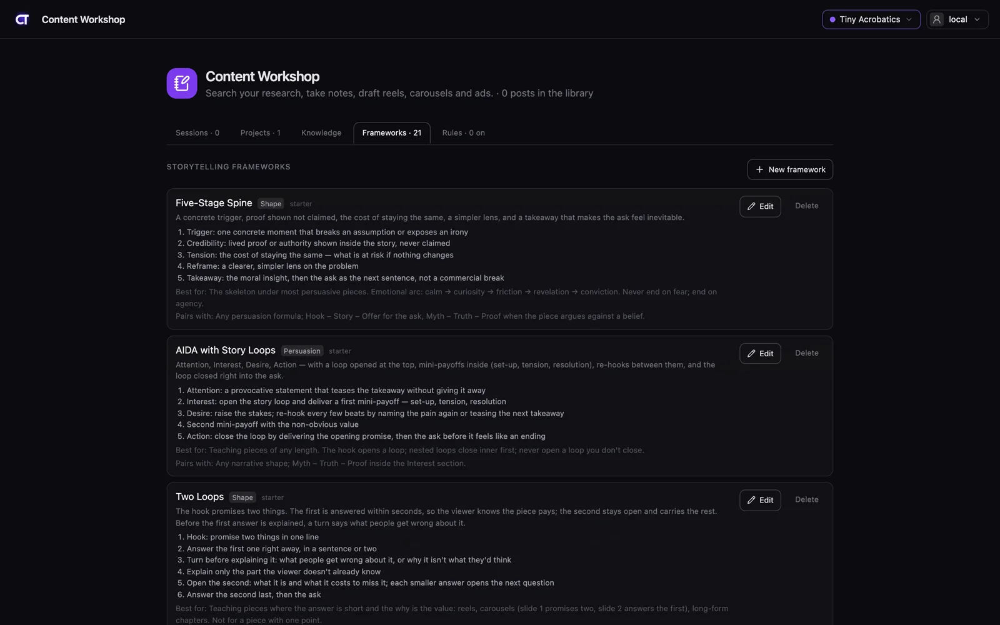

<p align="center">
  
</p>

<h1 align="center">Creator Toolset</h1>

<p align="center">
  Plan, make and distribute video, in one app that runs on your own machine.
  <br />
  <a href="../../releases/latest"><b>Download for Mac</b></a> ·
  <a href="#run-it-from-source">Run from source</a> ·
  <a href="SELF_HOSTING.md">Self-host</a> ·
  <a href="LICENSE">MIT</a>
</p>

<p align="center">
  
</p>

Creator Toolset is for people who make video and content for a living. You can caption a video, get feedback
from a client on the exact frame, cut raw takes into a draft timeline, and study which posts work before you
write the next one. It has one sign-in and one data folder. Your files stay on your Mac or your server, and
any AI it uses runs on your own account.

## The tools

The home screen follows how a video gets made: **Plan → Make → Distribute**, with the **Extras** underneath.

### Caption Studio



Drop in a video and Whisper transcribes the speech in your browser. Once a cloud transcription key serves your
account (your own, or the server's if you are its admin), that service becomes the default and gets the audio. The
browser model stays in the list, and the engine you pick yourself is kept. The video itself is saved on the server the app runs on,
which in the Mac app is your own Mac. Each line of the transcript
becomes a caption you can edit, restyle and move on the timeline. You export the video with the captions burned in
(MP4, H.264 or H.265), or the captions alone: a transparent overlay (ProRes 4444, VP9 WebM or a PNG sequence) that
goes on top of your edit, or an SRT, WebVTT or ASS file.

### Review



Upload a cut and share one link. Reviewers comment on the exact frame, draw on the picture, and approve or ask
for changes, all without an account. Reviewers have to be able to reach the server the link came
from: a link from the Mac app opens on that Mac, and on your own network once **Access from other devices** is on
and you put the Mac's address in the link in place of `127.0.0.1`, so for a reviewer on the internet you need
[your own server](SELF_HOSTING.md). Each new version stacks on the same video, so you can compare V1 with V2.
Upload the timeline file too (OTIO, FCP 7 XML, FCPXML or EDL) and its tracks show under the player.

### Content Workshop



This is where you write reel scripts, carousels, ads, YouTube scripts, newsletters, X threads and articles.
Research a topic across the posts you've saved, keep notes, and draft with AI in your own voice, using a
storytelling framework you pick. Before you post, the accuracy check tests the claims against the web. Each project
keeps its own instructions (who you write for, how you sound, what never to say), and the AI reads only the
project you're in.

### And the rest

| Stage | Tool | What you do with it |
|---|---|---|
| Plan | **Content Analyzer** | Save Instagram accounts and posts, and YouTube videos, with captions, transcripts, comments and numbers. Search them, rate each from one to five stars, and sort by rating or plays. With a TypeSafe Jev key, an account's page adds **What works**: how its posts did by hook, format and call to action. |
| Make | **Media Library** | Your footage in one place, with search, watch folders, folders, smart folders, share links and a trash. |
| Make | **AI Editor** | Pick raw takes from the Media Library, or add files from your computer, and say what the video is. The AI picks the best take of each line and cuts the restarts and pauses. You get draft timelines for your own editor, with a preview in Review. |
| Distribute | **Finals** | Your finished reels, carousels and other pieces: the versions of each, the winner, and where it was posted. |
| Extras | **Audio Enhancer** | Clean up the sound of a recording, with a before-and-after player. |
| Extras | **Story Splitter** | Cut a video into stories of about 20 seconds, on its own cuts, pauses and beats, and download them as one zip. |
| Extras | **Designer** | Carousels, covers and thumbnails as pages of layers: your AI designs them (text, shapes, pictures, its own drawings), you move, resize, retype and restyle anything on a canvas, and save each page as a PNG. Start from a Workshop carousel, a video's frame, or blank pages. |
| Extras | **Video Notes** | Screen and camera recordings. Each one gets a transcript (through your cloud transcription key when you have one; without a key the Mac app makes it on your Mac, and a server makes none) and, with an AI connected, a title, a summary and chapters. |
| Extras | **Guide Builder** | Put recordings in order, have AI draft a step-by-step page, and publish it as an unlisted link. |
| Extras | **Screen Recorder** | In the Mac app, on macOS 15 or newer: record your screen, a window or an area, with your camera and voice. Make a version that zooms where you clicked, and send it to Review, Video Notes or the Guide Builder; or one with no background, saved as a video with a transparent background to lay over other video. |

On the home screen Review sits in Make, the Content Workshop in Plan and Caption Studio in the Extras.

Around the tools there are also a **Mac app** (below), an **[Obsidian plugin](apps/obsidian/README.md)** that keeps
vault notes and Workshop sessions in step, and an **assistant**: a chat docked in the app that answers on the AI
app you connected on your own computer (Settings → Providers), never on an API key. With Claude Code, Codex, Gemini
or Grok it works with the app's own tools: it sets things up with you, reads and changes your Workshop, Review and
AI Editor work, schedules tasks, and sends a video you drop on it to Video Notes, Review or Caption Studio.
What you tell it about yourself and your work it keeps for later chats, in your own words: Settings → Memory lists
what is kept, each with a Remove.

## Make it work your way

The app is open source, so your AI can change it for you. Give this repository to Claude Code, Codex or another
coding AI and say what you want different: a tool you miss, a step that should go another way, a page for your own
process. It builds that as a **plug-in**, a folder of your own. With the Mac app you install nothing: your AI writes
the folder, and you switch it on in Community → Installed. The app's code stays as it is, so you keep getting
updates. [PLUGINS.md](PLUGINS.md) tells your AI how.

## Your own AI, your own keys

Creator Toolset doesn't come with an AI account. You bring your own, in one of two ways:

1. **Your subscription, on your Mac.** Install Claude Code or Codex and sign in with your own plan. The Mac app
   passes your requests to it, and only yours. Settings → Providers walks you through it.
2. **Your API key.** Add an Anthropic key in Settings → API keys. Anthropic bills you directly.

Every other paid service works the same way: cloud transcription, audio engines, research and Apify each run on
a key you add, and that provider bills you. Instagram is read only through the official login (for your own posts)
and your own Apify key (for other creators), never by scraping web pages.

You can also skip the window and work from the AI chat you already use. Creator Toolset adds itself to Claude
Code or Codex as an MCP server, with a key that only works for you, and Settings → Headless access shows the
address and key for any other MCP app. From that chat you can draft and edit Workshop pieces, read and resolve
Review comments, run AI Editor steps and schedule tasks.

Without any AI, the rest still works. Captions transcribe in the browser, and Review, Story Splitter and the Media
Library need no AI at all.

## Run it on your Mac

The Mac app (Apple silicon, macOS 14 or newer; its Screen Recorder needs macOS 15) has the whole server inside it,
so there's nothing else to install.

1. **Download it** from [Releases](../../releases/latest): open the disk image and drag Creator Toolset to
   Applications. It updates itself after that.
2. **Open it.** It starts the server and makes your account. It doesn't ask for a password, because the
   account's secret is kept in your Keychain.
3. **Follow the setup.** It has three screens. **Connect your AI** lists the AI apps on this Mac for the ChatGPT,
   Claude, Google, Grok or Meta plan you already have: Install, Sign in or Connect on a row does that step for you.
   **What do you make?** turns on the tools that fit and makes your first project. **How do you work best?** asks
   whether you talk to your AI in the app, in your own AI, or both; for your own AI, a last screen adds Creator
   Toolset to Claude Code or Codex with one click. Sign-in, the Instagram login and other keys are optional.
4. **Use it from other devices (optional).** Turn on **This Mac → Access from other devices** (Servers → This Mac…
   in the app's menu bar) and choose a password. Phones and other computers sign in with it.

Your data lives in `~/Library/Application Support/Creator Toolset/data`. You can move it to an external disk
in **This Mac → Data location**.

The downloaded app sends anonymous usage and crash reports to creatortoolset.com, which may pass them to PostHog
and Sentry. A report holds a random install id, the version and system, which of the app's pages were opened and how
often, whether Connect is on, which kinds of AI are set up, and the message and code location of any error. It never
holds your name, account, files or content. Turn it off in **Settings → General → Send anonymous usage and crash
reports**. A server you build or host yourself sends none (`api/lib/telemetry.ts`).

The **Servers** menu, or the picker right of the window buttons, switches the window between this Mac's server and
any server of yours added by address (⌥⌘1…⌥⌘9). **Servers → Run your own server…** walks you through one.
More in [apps/mac/README.md](apps/mac/README.md).

## Run it from source

You need Node.js 22+, [pnpm](https://pnpm.io) 10 (`corepack enable`), and `ffmpeg` and `zip` on your PATH.

```sh
git clone <this repository> creator-toolset
cd creator-toolset
pnpm install
pnpm --filter @creator-toolset/captions dev   # http://localhost:43127
```

With no `.env`, sign-in is off and you are the local admin. Projects are kept in `~/.caption-studio`
(set `DATA_DIR` to change it). Every setting is explained in [apps/captions/.env.example](apps/captions/.env.example).
`pnpm test` and `pnpm check` run the tests and the type check.

## Run it on your own server

[SELF_HOSTING.md](SELF_HOSTING.md) is written so that you, or an AI agent, can follow it step by step. It covers
choosing a server and a domain, starting the Docker kit (the app plus Caddy for HTTPS), connecting the Mac app,
backups and updates. On the server, `apps/captions/scripts/setup-server.sh <your domain>` writes `.env` with a random
`APP_SECRET` and starts the kit in one go. `pnpm run doctor` checks a running install and lists what's missing.

To let your own computers join one account through Cloudflare Tunnel, run the Connect broker in
[apps/relay/](apps/relay/) with your own Cloudflare zone. [docs/operations/self-host-relay.md](docs/operations/self-host-relay.md)
is the step-by-step guide.

## Repository

| Path | What |
|---|---|
| [`apps/captions/`](apps/captions/README.md) | The web app and its server: React, Vite, Hono, tRPC, TypeScript |
| [`apps/mac/`](apps/mac/README.md) | The Mac app (SwiftUI) |
| [`apps/obsidian/`](apps/obsidian/README.md) | The Obsidian plugin |
| [`SELF_HOSTING.md`](SELF_HOSTING.md) | Running it on your own server |
| [`docs/operations/self-host-relay.md`](docs/operations/self-host-relay.md) | Running the Connect broker on your own server |
| [`PLUGINS.md`](PLUGINS.md) | Changing the app for yourself with a plug-in |
| [`AGENTS.md`](AGENTS.md) | Rules and commands for contributors and their coding agents |

## Contributing

Read [AGENTS.md](AGENTS.md) first. Turn on the repository hooks once per clone with
`git config core.hooksPath .githooks`. They block any commit that contains a secret or a private name.

## License

[MIT](LICENSE). Copyright (c) 2026 Creator Toolset contributors.

The fonts in `apps/captions/public/fonts/` are Google Fonts under the SIL Open Font License 1.1 (see `OFL.txt`
there). Other third-party parts, including the GPL FFmpeg build that the Docker image downloads, are listed in
[THIRD_PARTY_NOTICES.md](THIRD_PARTY_NOTICES.md).

The footage in the screenshots is from *Tears of Steel*, (CC) Blender Foundation | [mango.blender.org](https://mango.blender.org),
licensed [CC BY 3.0](https://creativecommons.org/licenses/by/3.0/).
